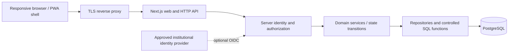

# System architecture and technology decisions

## Proposed modular monolith

One deployable app reduces operational complexity and distributed transaction risks. Modules: identity, catalogue, inventory, requests/approvals, lending/returns, comments/audit, reporting. Routes/server actions are adapters: parse, authenticate, call service, return minimal DTO. Services own authorization and transitions; repositories cannot be imported into client code. No policy decisions solely in middleware/layout or hidden buttons. Every entry point follows the same service boundary. No microservices, Redis, queues or external analytics until evidence requires them.

## Technology decisions

| Proposal                   | Decision and reason                                                                                                                                                                                                                                                  |
| -------------------------- | -------------------------------------------------------------------------------------------------------------------------------------------------------------------------------------------------------------------------------------------------------------------- |
| Next.js, React, TypeScript | Accept provisionally, maintained compatible releases selected before M1; strict types and server-only DAL. Boundaries prevent server-rendered private data leakage.                                                                                                  |
| Tailwind, shadcn/ui        | Accept; small coherent component set, reviewed generated component code; accessibility still requires verification.                                                                                                                                                  |
| PostgreSQL                 | Accept; transactional authoritative ledger, constraints, locks, scoped roles and SQL procedures.                                                                                                                                                                     |
| Prisma                     | Accept conditionally as typed data/migration tool; handwritten reviewed SQL required for grants, triggers, partial uniqueness, locking and transition procedures. ORM alone is not an integrity boundary. Validate compatible transaction API before implementation. |
| Auth.js / SSO              | Evaluate maintained Auth.js release/adapter and session semantics at M1; institution OIDC preferred. Use revocable DB-backed app sessions and current server grants; do not depend on stale role JWT claims. No live IdP connection in Phase 1.                      |
| Docker                     | Accept for reproducible local/staging artifacts after authorization; non-root runtime, pinned bases, no mounted Docker socket. Deployment remains separate approval.                                                                                                 |
| Responsive PWA             | Accept manifest/installable shell; defer offline protected pages and writes. Service worker caches public static assets only; never cache session, student records or exports.                                                                                       |

Versions are deliberately unpinned in planning. Before installation: compatibility ADR for Node LTS, Next/React, Prisma/Postgres, auth adapter and security support; no unsupported release selected merely because it is newest.

## Interfaces and failure handling

Versioned HTTP API `/api/v1` with documented OpenAPI contract; domain commands include submit, decide, reserve, handover, receive-return, clear-inspection, transfer and adjust. POST mutations have idempotency key scoped to actor/command plus request hash. Reused key with different payload yields 409. Validation returns 422 with safe field errors; unauthenticated 401; denied 403 or consistent 404 for concealed records; state/stock conflict 409; rate limit 429. Public errors carry correlation ID, not SQL/stack traces. Paginate allowlisted sorts, bounded page sizes and strict filters.

Atomic mutation includes inventory ledger/projection, loan/approval changes, comment/audit event and idempotency result. Crash before commit changes nothing. External notifications, if later approved, use transactional outbox and deduplication; never make stock depend on mail delivery. Reservation expiration evaluated transactionally using database time. Explicit operator reconciliation until scheduled jobs approved.

## Data security and operation

Separate migration owner, application role, reporting read role and backup role. No application schema ownership, DDL, bypass-RLS, role creation or arbitrary audit mutation. SQL functions use fixed search path, narrow execute grants and validated arguments. DB triggers/constraints enforce history and quantity invariants independently of route code. Server record authorization remains mandatory even if RLS is added. Do not assert actor identity in DB alone proves the end-user: the server is a trusted identity boundary; compromise of it remains a residual risk.

Secrets injected by authorized operator; none in repository/images/logs. TLS, encrypted database volumes/backups, narrow network access, structured safe logs, readiness/liveness probes, connection pool budget, restore rehearsals. No production access has been requested or enabled.

Sources: [Next.js authentication](https://nextjs.org/docs/app/guides/authentication), [data security](https://nextjs.org/docs/app/guides/data-security), [PostgreSQL isolation](https://www.postgresql.org/docs/current/transaction-iso.html), [Prisma transaction documentation](https://www.prisma.io/docs/orm/fundamentals/transactions). Transaction failure retry and compatibility must be proven against selected versions.
