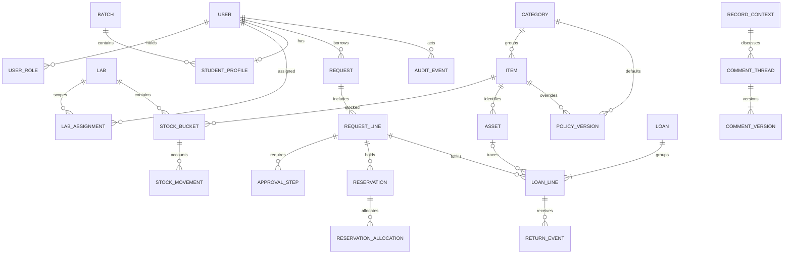

# Logical database / ER specification

This is a logical design, not an executable Prisma schema or migration. IDs use opaque UUIDs; physical units also have immutable human-readable asset codes. UUID unpredictability is not authorization. FK deletion defaults RESTRICT for historical records; user deactivation replaces destructive deletion. Dates use timestamptz except academic/date-only labels.

## Entities and key constraints

| Entity | Principal columns and constraints |
|---|---|
| User / AuthIdentity / Session | immutable user ID; display name, active; unique provider+subject; hashed opaque session token, expiry/revokedAt; no plaintext tokens in logs |
| UserRole / CapabilityGrant | user, role, capability/scope, effective dates; grant provenance; prevent unreviewed role elevation |
| Batch / StudentProfile | batch code unique; registrationNo normalized unique; user unique; current batch FK; profile history records cohort changes |
| Lab / LabAssignment | lab code unique; user, function lecturer/TO, validity; approval eligibility derived from current assignments plus explicit substitute grants |
| Category / Item | category parent optional; item kind, unit, active; restrict changing kind once movement exists |
| PolicyVersion | exactly one item OR category FK (XOR check), revision unique per owner, mode, effective time, creator; immutable; optional student selector rule |
| StockBucket | unique item+lab+lot/state/identity-pool key; nonnegative quantity; version for optimistic checks; quantities updated only by controlled procedures |
| Asset / AssetIdentityEvent | item, immutable unique assetCode, current lab, state, optional manufacturer/normalized serial; serial correction appends identity event; one asset represents one unit |
| Request | borrower, created/submitted times, purpose; state summary derived; immutable submitted identity; version |
| RequestLine | request, item, lab, positive qty; policy snapshot + policyVersion; selected lecturer; requested dates; decision/reservation/fulfilment summaries |
| ApprovalStep / Decision | line, stage/order, assigned approver and capability snapshot; append-only decision with author/role/time/remarks; one effective terminal decision per stage revision; no borrower actor |
| Reservation / Allocation | line, positive qty, expiry, state; allocation either anonymous bucket quantity or specific asset, never both; current active allocations bounded by stock |
| Loan / LoanLine | borrower, issuing TO, physical handover time; line references requestLine; quantity, dueAt, borrower batch snapshot, kind; asset FK nullable only for consumables; asset-backed lines qty=1 |
| ReturnEvent / Inspection | loanLine, positive received qty, receiving TO, time, condition; cumulative returned <= issued; inspection disposition and separate clearing actor where needed |
| StockMovement / MovementEntry | command, item, lab, asset optional, reason, actor/time; balanced entries between explicit state/location pools; append-only; unique command key |
| Transfer / Adjustment | proposal, source/destination, quantities, reason, proposer, independent decision; posted movement reference unique |
| RecordContext | typed record association with concrete nullable FKs and exactly-one-parent check; avoids unenforced arbitrary object IDs |
| CommentThread / CommentVersion | context, visibility, original author; version number, predecessor FK, actor, role snapshot, time, text; unique predecessor/thread version prevents branches |
| AuditEvent | actor/role, event type, target context, safe before/after, correlation, timestamp; immutable and separate from comments |
| IdempotencyRecord | actor+command+key unique; payload digest, result reference/status; expiry policy cannot permit duplicate physical commands |
| ImportBatch / ImportRow | uploader, source digest, validation/preview decisions, row key, commit result; unique batch+row; staged until approved commit |

## Integrity and indexing

Index active approval assignees/state, request borrower/time, loans borrower/due/open, batch snapshots, asset code/normalized serial, item/lab balances, movements item/lab/time, comments context/time and audit target/time. Partial unique index: at most one active loan/allocation per physical asset; states and loans must move through reviewed functions together. Cross-table totals cannot be protected by simple CHECK constraints alone: lock shared aggregate rows, verify quantities, write ledger and projections in one transaction. Unidentified-to-asset conversion uses paired movement entries, no stock creation.

Historical policy snapshots are immutable structured data with version reference. Current role/assignment grants are rechecked at action time: revoked approvers cannot continue solely because assigned earlier. Unavailable approver requires audited reassignment. DB FK/check/unique enforcement plus domain tests required. Final physical schema, indexes and migration rollback are review deliverables in M1/M3; unresolved policy P01/P02/P11 affects details.
