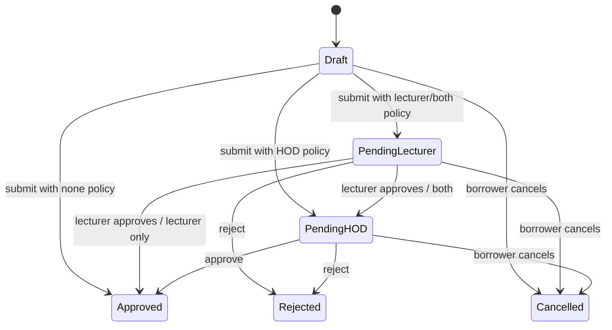
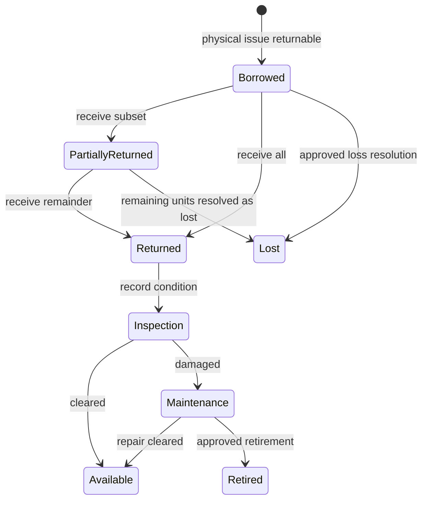

# State machines and transition rules

## Approval per request line

Submission snapshots policy and validates eligible lecturer, dates, quantities and identity conflicts. Decisions are append-only and compare expected stage/version. Repeated decisions cannot duplicate effects. Rejection terminal for that revision; resubmission creates new line/request revision linked to original, re-evaluates policies and retains prior decisions. Submitted quantities/items cannot be edited in place.

## Allocation and fulfilment, independent of approval

Approved → AwaitingStock → Reserved → PartiallyIssued → Issued. Approval may attempt reservation atomically; insufficient stock leaves AwaitingStock without a loan. None-policy means academic stage satisfied only; TO still verifies handover. Available stock is checked again under lock. Expired reservation releases only unissued quantity and returns to AwaitingStock; cancellation closes only unissued quantity. Already issued quantity continues as a loan. Partial reservations/handovers are explicit quantities, not a single lossy state flag. Reservation expiry never cancels an existing loan.

Handover guard: authorized different TO, active borrower, current approval, live allocation, physical confirmation, serial/identity validation, dueAt after handover for returnables, issued cumulative <= approved quantity. One transaction consumes reservation and issues loan; approval alone cannot call issue. Rejected/cancelled lines cannot reserve or issue. Loss/retirement of reserved asset invalidates its allocation under the same inventory lock.

## Loan and return

Diagram summarizes quantities; individual assets have independent states. Overdue is derived: dueAt < DB now and unresolved returnable quantity >0; it is not a mutually exclusive physical state. Loss closes outstanding custody into a lost account, distinct from physical return. Recovery of a lost unit appends recovery movement and inspection, never rewrites loss history. Consumables: reserved → issued/consumed, no return due or overdue; mistaken issue reversal is controlled adjustment with audit.

Return receipt permits no more than outstanding quantity, records actual receiving officer and condition; received items enter inspection or maintenance, not automatically available. Due extensions need an authorized independent approval record retaining original due date and reason. Borrower can request extension but cannot approve own extension. Transfers: proposed → independently approved → in-transit → received; no borrowing from transit. Cancellation/reversal records compensating movements.

Request header is derived summary (draft/pending/mixed/ready/partially fulfilled/fulfilled/closed) from line approval, allocation and fulfilment dimensions. UI displays counts and line states. Request closure requires every line's unissued remainder closed and each issued returnable resolved; consumables count fulfilled at physical issue. No header state may authorize bypassing line guards.
